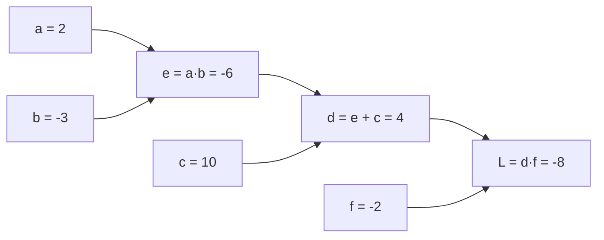
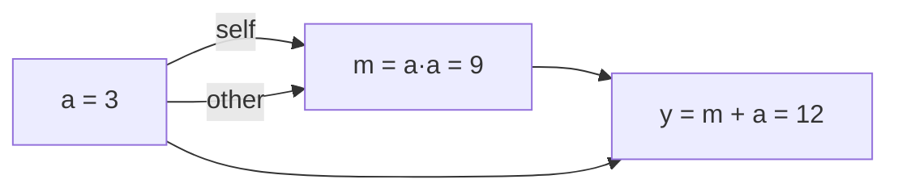

# Step 01. Reverse-mode 자동미분 (Autograd)

- 구현: `minillm/autograd.py` — `Value`의 각 연산 `_backward`, `Value.backward`
- 테스트: `pytest tests/test_01_autograd.py`

## 1. 목표

스칼라 단위의 계산 그래프를 만들고, 역전파(reverse-mode automatic differentiation)로 모든 입력에 대한 gradient를 한 번에 계산한다. 이후 단계에서는 PyTorch autograd를 쓰지만, 그 내부 동작을 직접 구현해 보는 것이 이 단계의 목적이다.

## 2. 이론

### 2.1 계산 그래프와 adjoint

스칼라 출력 $L$을 계산하는 프로그램은 중간값 $v_1, \dots, v_n$으로 이루어진 DAG로 표현된다. 각 노드는 $v = f(u_1, \dots, u_k)$ 형태의 기본 연산이다.

노드 $v$의 adjoint를 $\bar v := \partial L / \partial v$로 정의한다. 다변수 chain rule에 의해, 노드 $u$를 입력으로 쓰는 모든 소비자(consumer) $v$에 대해

$$\bar u = \sum_{v \in \mathrm{consumers}(u)} \bar v \, \frac{\partial v}{\partial u}$$

가 성립한다. 따라서 각 연산은 "출력의 adjoint $\bar v$에 국소 미분 $\partial v / \partial u_i$를 곱해 입력의 adjoint에 **더한다**"는 규칙만 알면 된다. 한 노드가 여러 번 사용될 수 있으므로 대입(`=`)이 아니라 누적(`+=`)이어야 한다.

### 2.2 기본 연산의 국소 미분

| 연산 $v$ | $\partial v/\partial u$ |
|---|---|
| $u_1 + u_2$ | $1,\ 1$ |
| $u_1 u_2$ | $u_2,\ u_1$ |
| $u^k$ ($k$ 상수) | $k u^{k-1}$ |
| $e^u$ | $e^u$ (= 출력값 $v$) |
| $\log u$ | $1/u$ |
| $\tanh u$ | $1 - \tanh^2 u$ (= $1 - v^2$) |
| $\mathrm{ReLU}(u)$ | $\mathbb{1}[u > 0]$ |

$e^u$, $\tanh u$처럼 미분이 출력값으로 표현되는 경우 forward에서 계산한 값을 재사용한다.

### 2.3 계산 순서: 역위상 정렬

$\bar u$를 확정하려면 $u$의 모든 소비자 $v$의 $\bar v$가 먼저 확정되어야 한다. DFS 후위 순회(post-order)로 얻은 위상 정렬 순서는 "모든 입력이 출력보다 앞에 오는" 순서이므로, 이를 **역순**으로 처리하면 위 조건이 만족된다. 시작점은 $\bar L = \partial L / \partial L = 1$이다.

### 2.4 Forward mode와의 비교, 계산 비용

- Forward mode는 Jacobian-vector product $J\dot x$를 계산한다. 입력이 $n$개면 전체 gradient를 얻는 데 $n$번의 pass가 필요하다.
- Reverse mode는 vector-Jacobian product $\bar y^\top J$를 계산한다. 출력이 스칼라 1개이면 **1번의 backward pass**로 모든 입력의 gradient를 얻는다.

신경망은 입력(파라미터)이 수백만~수십억 개, 출력(loss)이 1개이므로 reverse mode가 적합하다. Reverse mode의 시간 비용은 forward 비용의 작은 상수배로 유계이다(cheap gradient principle; Griewank & Walther). 대신 backward 때 국소 미분에 필요한 forward 중간값을 모두 보관해야 하므로 **메모리**가 그래프 크기에 비례한다. 학습 시 activation 메모리가 큰 이유이며, gradient checkpointing은 이 메모리를 재계산으로 교환하는 기법이다.

## 3. 예제로 따라가기

### 3.1 계산 그래프 하나를 손으로 역전파하기

$a = 2,\ b = -3,\ c = 10,\ f = -2$일 때 $L = (a\cdot b + c)\cdot f$를 계산한다. 중간값에 이름을 붙이면 $e = a\cdot b$, $d = e + c$, $L = d\cdot f$이다.



**Forward** (왼쪽 → 오른쪽): $e = -6$, $d = 4$, $L = -8$.

**Backward** (오른쪽 → 왼쪽). 각 줄은 "출력의 adjoint × 국소 미분"을 입력에 더하는 한 번의 `_backward` 호출이다.

| 처리 순서 | 노드의 `_backward` | 국소 미분 | 입력에 더해지는 값 | 결과 |
|---|---|---|---|---|
| 0 | (시작) | | | $\bar L = 1$ |
| 1 | $L = d\cdot f$ (mul) | $\partial L/\partial d = f$, $\partial L/\partial f = d$ | $\bar d \mathrel{+}= f\cdot\bar L$, $\bar f \mathrel{+}= d\cdot\bar L$ | $\bar d = -2$, $\bar f = 4$ |
| 2 | $d = e + c$ (add) | $1,\ 1$ | $\bar e \mathrel{+}= \bar d$, $\bar c \mathrel{+}= \bar d$ | $\bar e = -2$, $\bar c = -2$ |
| 3 | $e = a\cdot b$ (mul) | $\partial e/\partial a = b$, $\partial e/\partial b = a$ | $\bar a \mathrel{+}= b\cdot\bar e$, $\bar b \mathrel{+}= a\cdot\bar e$ | $\bar a = 6$, $\bar b = -4$ |

검산: $L = (ab + c)f$를 직접 미분하면 $\partial L/\partial a = bf = (-3)(-2) = 6$, $\partial L/\partial b = af = -4$, $\partial L/\partial c = f = -2$, $\partial L/\partial f = ab + c = 4$. 표와 같다.

**수치 미분으로 확인하기.** $h$를 아주 작게 두고 $(L(a + h) - L(a))/h$를 계산하면 기울기의 근삿값이 나온다. $h = 10^{-4}$이면 $6.0000000000$으로, 역전파 결과 $6$과 일치한다. 구현이 맞는지 의심될 때 쓰는 가장 기본적인 검산법이다(gradient check).

### 3.2 처리 순서: 위상 정렬을 뒤집는 이유

`backward()`는 DFS 후위 순회로 위상 순서를 만든다. 위 그래프에서 가능한 한 가지 결과는 다음과 같다(같은 깊이의 노드 순서는 구현에 따라 다를 수 있다).

| | 순서 |
|---|---|
| 위상 순서 (입력 → 출력) | `a, b, e, c, d, f, L` |
| `_backward` 호출 순서 (뒤집음) | `L, f, d, c, e, b, a` |

$e$의 `_backward`(3번 줄)는 $\bar e$가 완성된 뒤, 즉 $e$를 쓰는 $d$의 `_backward`(2번 줄)가 끝난 뒤에 호출되어야 한다. 순서를 거꾸로 하면 $\bar e = 0$인 상태로 전파되어 $\bar a = \bar b = 0$이 된다.

### 3.3 같은 노드를 두 번 쓰면: `+=`가 필요한 이유

$a = 3$, $y = a\cdot a + a$. 정답은 $dy/da = 2a + 1 = 7$이다.



$a$로 들어오는 경로가 세 개다.

| 경로 | 기여 |
|---|---|
| $y = m + a$의 두 번째 입력 | $1$ |
| $m = a\cdot a$의 `self` 쪽 | $\text{other} \times \bar m = 3 \times 1 = 3$ |
| $m = a\cdot a$의 `other` 쪽 | $\text{self} \times \bar m = 3 \times 1 = 3$ |
| 합 | $7$ |

세 기여가 모두 같은 `a.grad`에 더해져야 한다. `=`로 대입하면 마지막에 쓴 값만 남는다(해설 01의 1번 참고).

### 3.4 국소 미분을 숫자로 감 잡기

| 연산 | 입력 $u$ | 출력 $v$ | $\partial v/\partial u$ | 메모 |
|---|---|---|---|---|
| $u^3$ | 2 | 8 | $3u^2 = 12$ | |
| $e^u$ | 1 | 2.7183 | $e^u = 2.7183$ | 출력값을 그대로 재사용 |
| $\log u$ | 4 | 1.3863 | $1/u = 0.25$ | |
| $\tanh u$ | 0.5 | 0.4621 | $1 - v^2 = 0.7864$ | 출력값으로 계산 |
| $\mathrm{ReLU}(u)$ | $-1.5$ | 0 | 0 | 음수 입력은 gradient가 막힌다 |
| $\mathrm{ReLU}(u)$ | 1.5 | 1.5 | 1 | |

### 3.5 구현 후 직접 확인

```python
from minillm.autograd import Value

a, b, c, f = Value(2.0), Value(-3.0), Value(10.0), Value(-2.0)
L = (a * b + c) * f
L.backward()
print(L.data, a.grad, b.grad, c.grad, f.grad)   # -8.0 6.0 -4.0 -2.0 4.0
```

출력이 3.1의 표와 같으면 add, mul, backward가 맞게 구현된 것이다.

## 4. 구현 가이드

- 각 연산에서 `out`을 만든 뒤 `_backward` closure가 `self`, `other`, `out`을 캡처한다. closure 안에서 `out.grad`(= $\bar v$)를 읽어 입력의 `.grad`에 누적한다.
- `__sub__`, `__truediv__`, `__neg__` 등은 이미 `+`, `*`, `**`로 정의되어 있으므로 따로 구현할 필요가 없다.
- `backward()`: (1) `self`에서 시작하는 DFS로 위상 정렬 리스트를 만들고 (2) `self.grad = 1.0` (3) 역순으로 `_backward()` 호출.
- 재귀 DFS는 Python 재귀 한도(기본 1000)에 걸릴 수 있다. 테스트 규모에서는 문제없지만, 반복문 기반 DFS로 바꿔 보는 것도 연습이 된다.

## 5. 검증

`tests/test_01_autograd.py`는 (1) 여러 연산을 섞은 식의 값과 gradient를 `torch.float64` autograd와 비교, (2) 같은 노드를 재사용할 때 gradient 누적, (3) 깊은 체인의 위상 순서를 검사한다.

## 6. 확인 문제

> 해설: [answers/01_autograd.md](answers/01_autograd.md) — 먼저 직접 풀어 본 뒤 확인할 것.

1. `+=` 대신 `=`로 구현하면 `b = a * a + a`의 `a.grad`는 얼마가 나오는가?
2. `backward()`를 두 번 연속 호출하면 어떤 일이 생기는가? PyTorch에서 `optimizer.zero_grad()`가 필요한 이유와 연결해 설명하라.
3. 출력이 $m$개, 입력이 $n$개인 함수의 전체 Jacobian을 구할 때 forward/reverse mode 각각 몇 번의 pass가 필요한가?

## 참고문헌

- A. G. Baydin et al., "Automatic Differentiation in Machine Learning: a Survey," JMLR 2018.
- A. Griewank, A. Walther, *Evaluating Derivatives*, 2nd ed., SIAM 2008.
- A. Karpathy, micrograd (github.com/karpathy/micrograd) — 본 단계의 구조가 참고한 최소 구현.
