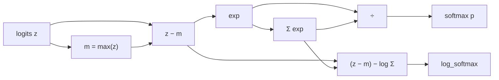

# Step 02. Softmax, Log-Softmax, Cross-Entropy와 그 역전파

- 구현: `minillm/functional.py` — `softmax`, `log_softmax`, `cross_entropy`, `cross_entropy_backward`
- 테스트: `pytest tests/test_02_softmax_xent.py`
- 이 함수들은 이후 attention(step 06), GPT loss(step 10), DPO(step 17) 등에서 그대로 재사용된다.

## 1. 목표

LM 학습의 출력층(softmax + cross-entropy)을 torch 내장 함수 없이 수치적으로 안정되게 구현하고, gradient $\partial L/\partial z = p - y$를 직접 유도·구현한다.

## 2. 이론

### 2.1 Softmax와 shift 불변성

$$p_i = \mathrm{softmax}(z)_i = \frac{e^{z_i}}{\sum_j e^{z_j}}$$

임의의 상수 $c$에 대해 $\mathrm{softmax}(z + c\mathbf{1}) = \mathrm{softmax}(z)$이다(분자·분모에 $e^c$가 약분된다).

fp32에서 $e^x$는 $x > 88.7$이면 overflow(inf)한다. $m = \max_j z_j$를 빼면 지수의 최댓값이 0이 되어 overflow가 없고, 분모에 최소 하나의 항 $e^0 = 1$이 있으므로 분모가 0이 되지도 않는다.

### 2.2 Log-softmax와 log-sum-exp

$$\log p_i = z_i - \mathrm{LSE}(z), \qquad \mathrm{LSE}(z) = m + \log \sum_j e^{z_j - m}$$

`log(softmax(z))`로 계산하면 $p_i$가 underflow로 0이 되는 경우 $\log 0 = -\infty$가 된다. 위 식은 $p_i$를 거치지 않으므로 안정적이다.

### 2.3 Cross-entropy와 최대우도

정답 클래스 $y$에 대해 $L = -\log p_y$. 데이터셋 평균 cross-entropy를 최소화하는 것은 조건부 로그우도 $\sum_n \log p_\theta(y_n \mid x_n)$를 최대화하는 것과 같다(MLE). 또한 one-hot 분포 $\delta_y$와 모델 분포 사이의 cross-entropy $H(\delta_y, p) = \mathrm{KL}(\delta_y \| p) + H(\delta_y)$이고 $H(\delta_y) = 0$이므로 KL 최소화와도 동일하다.

배치 $N$개 중 `ignore_index` 위치를 제외한 집합을 $M$이라 하면

$$L = \frac{1}{|M|} \sum_{n \in M} -\log p_{n, y_n}.$$

SFT(step 15)에서 프롬프트 토큰을 loss에서 제외할 때 이 마스킹을 사용한다.

### 2.4 Gradient 유도

$\log p_y = z_y - \mathrm{LSE}(z)$이고 $\partial \mathrm{LSE}/\partial z_i = p_i$이므로

$$\frac{\partial L}{\partial z_i} = -\frac{\partial \log p_y}{\partial z_i} = p_i - \mathbb{1}[i = y].$$

즉 gradient는 "예측 확률 − one-hot 정답"이다. 평균 loss라면 $1/|M|$을 곱하고, 무시된 행은 0이다.

비교를 위해 softmax의 Jacobian은 $\partial p_i / \partial z_j = p_i(\delta_{ij} - p_j)$, 즉 $J = \mathrm{diag}(p) - pp^\top$($C \times C$, 대칭, 양의 준정부호, rank $\le C-1$)이다. softmax와 CE를 합쳐서 미분하면 Jacobian을 만들 필요 없이 $O(C)$에 gradient를 얻는다. 프레임워크들이 `cross_entropy`를 softmax와 분리하지 않고 fused 연산으로 제공하는 이유이다.

성질: $\sum_i \partial L/\partial z_i = 0$ (모든 logit에 같은 값을 더해도 loss 불변이므로), $\|\nabla_z L\|_2 \le \sqrt{2}$.

## 3. 예제로 따라가기

### 3.1 클래스 3개짜리 softmax를 한 줄씩

logit $z = [2.0,\ 1.0,\ 0.1]$, 정답 $y = 0$.

| 단계 | 클래스 0 | 클래스 1 | 클래스 2 | 비고 |
|---|---|---|---|---|
| $z$ | 2.0 | 1.0 | 0.1 | |
| $z - \max z$ | 0.0 | −1.0 | −1.9 | max-subtraction (결과는 동일) |
| $e^{z}$ | 7.3891 | 2.7183 | 1.1052 | 합 = 11.2125 |
| $p = e^z / \sum$ | **0.6590** | 0.2424 | 0.0986 | 합 = 1 |
| $\log p = z - \mathrm{LSE}(z)$ | −0.4170 | −1.4170 | −2.3170 | $\mathrm{LSE} = \log 11.2125 = 2.4170$ |
| one-hot $t$ | 1 | 0 | 0 | |
| $\partial L/\partial z = p - t$ | **−0.3410** | 0.2424 | 0.0986 | 합 = 0 |

loss는 $L = -\log p_0 = 0.4170$이다. gradient를 해석하면 다음과 같다.

- 정답 logit(클래스 0)의 gradient는 음수이다. gradient descent($z \leftarrow z - \eta\nabla$)는 이 logit을 **올린다**.
- 오답 logit의 gradient는 그 클래스의 예측 확률이다. 많이 틀리게 믿은 클래스일수록 많이 **내린다**.
- 세 값의 합은 0이다. 모든 logit에 같은 값을 더해도 softmax가 변하지 않기 때문이다.

### 3.2 왜 max를 빼야 하나: overflow 실험

$z = [1000,\ 1000,\ -1000]$.

| 방법 | 계산 | 결과 |
|---|---|---|
| 그대로 | $e^{1000} = \infty$, $\infty/\infty$ | `[nan, nan, 0]` |
| $\max = 1000$을 뺌 | $e^{0}, e^{0}, e^{-2000}$ = $1, 1, 0$ | `[0.5, 0.5, 0.0]` |

fp32에서 $e^x$는 $x > 88.7$이면 `inf`가 된다. max를 빼면 가장 큰 지수가 0이 되어 항상 안전하다.



### 3.3 배치와 `ignore_index`

배치 3개 중 세 번째 행은 학습에서 제외한다(`-100`).

| 행 | logit | target | $-\log p_{target}$ | 평균에 포함? |
|---|---|---|---|---|
| 0 | [2.0, 1.0, 0.1] | 0 | 0.4170 | O |
| 1 | [0.5, 2.5, 0.0] | 1 | 0.1967 | O |
| 2 | [1.0, 1.0, 1.0] | −100 | (1.0986, 무시) | X |

$L = (0.4170 + 0.1967)/2 = 0.3069$. 분모는 행 수 3이 아니라 **유효 행 수 2**이다.

`cross_entropy_backward` 결과는 행마다 $(p - t)/2$이고 무시된 행은 0이다.

| 행 | $\partial L/\partial z$ |
|---|---|
| 0 | [−0.1705, 0.1212, 0.0493] = 3.1의 값 ÷ 2 |
| 1 | [0.0556, −0.0893, 0.0337] |
| 2 | [0, 0, 0] |

구현 팁: target `-100`은 `gather`의 인덱스로 쓸 수 없으므로 `clamp(min=0)`으로 아무 유효 인덱스(0)를 넣고, 계산 후 마스크로 지운다.

### 3.4 확인 코드

```python
import torch
from minillm.functional import softmax, log_softmax, cross_entropy, cross_entropy_backward

z = torch.tensor([2.0, 1.0, 0.1])
print(softmax(z))        # tensor([0.6590, 0.2424, 0.0986])
print(log_softmax(z))    # tensor([-0.4170, -1.4170, -2.3170])

logits = torch.tensor([[2.0, 1.0, 0.1], [0.5, 2.5, 0.0], [1.0, 1.0, 1.0]])
targets = torch.tensor([0, 1, -100])
print(cross_entropy(logits, targets))           # tensor(0.3069)
print(cross_entropy_backward(logits, targets))  # 위 3.3의 표
```

## 4. 구현 가이드

- `x.amax(dim, keepdim=True)`로 최댓값을 빼고 `exp`, `sum`, `log`만 사용한다. `torch.softmax`, `F.softmax`, `F.log_softmax`는 테스트에서 금지(호출 시 실패)된다.
- `cross_entropy`: `targets`에 `-100`이 있으면 `gather` 인덱스로 쓸 수 없으므로 `targets.clamp(min=0)`으로 인덱싱한 뒤 마스크로 지운다. 분모는 `mask.sum().clamp(min=1)`로 0 나눗셈을 막는다.
- `cross_entropy_backward`: `softmax(logits)`가 새 텐서를 반환하므로 그 위에서 정답 위치에 1을 빼도 입력 `logits`는 변하지 않는다.

## 5. 검증

`F.softmax`, `F.log_softmax`, `F.cross_entropy(ignore_index=-100)`, autograd gradient와 float64로 비교하고, logit이 ±1000일 때 유한한 값이 나오는지 확인한다.

## 6. 확인 문제

> 해설: [answers/02_softmax_xent.md](answers/02_softmax_xent.md) — 먼저 직접 풀어 본 뒤 확인할 것.

1. $p_y \to 1$일 때와 $p_y \to 0$일 때 $\partial L/\partial z_y$는 각각 어디로 가는가? 학습 초기와 후기의 gradient 크기와 연결해 설명하라.
2. fp16(최댓값 65504)에서 max-subtraction 없이 softmax를 계산하면 $z$가 몇 이상일 때 overflow하는가?
3. label smoothing($y$를 $(1-\epsilon)\delta_y + \epsilon/C$로 대체)을 적용하면 gradient 식은 어떻게 바뀌는가?

## 참고문헌

- I. Goodfellow, Y. Bengio, A. Courville, *Deep Learning*, MIT Press 2016, §4.1, §6.2.2.3.
- J. S. Bridle, "Probabilistic Interpretation of Feedforward Classification Network Outputs," 1990.
