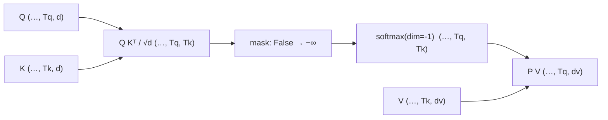

# Step 06. Scaled Dot-Product Attention

- 구현: `minillm/layers.py` — `scaled_dot_product_attention`
- 테스트: `pytest tests/test_06_attention.py`
- 선행: step 02 (`softmax`를 재사용)

## 1. 목표

Vaswani et al. (2017) §3.2.1의 식

$$\mathrm{Attention}(Q, K, V) = \mathrm{softmax}\!\left(\frac{QK^\top}{\sqrt{d_k}}\right)V$$

를 배치·헤드 차원을 포함한 임의의 선행 차원 `(..., T, d)`에 대해 구현한다. `F.scaled_dot_product_attention`과 torch 내장 softmax는 사용 금지다.

## 2. 이론

### 2.1 정의

query $q_i \in \mathbb R^{d_k}$에 대해 출력은 value들의 가중평균이다:

$$o_i = \sum_j \alpha_{ij} v_j, \qquad \alpha_{ij} = \frac{\exp(q_i^\top k_j/\sqrt{d_k})}{\sum_{j'}\exp(q_i^\top k_{j'}/\sqrt{d_k})}.$$

가중치 $\alpha_{i,:}$는 key 축에 대한 확률분포이므로 softmax는 **마지막 축(key 축)**에 적용한다. 이 형태는 kernel $\kappa(q, k) = \exp(q^\top k / \sqrt{d_k})$를 쓰는 Nadaraya–Watson 추정량과 같은 구조이며, kernel의 파라미터($W_Q, W_K$)가 학습된다는 점이 다르다.

### 2.2 $\sqrt{d_k}$ 스케일링의 근거

$q, k$의 각 성분이 독립이고 평균 0, 분산 1이라 가정하면

$$\mathrm{Var}(q^\top k) = \sum_{i=1}^{d_k}\mathrm{Var}(q_i k_i) = \sum_{i=1}^{d_k}\mathbb E[q_i^2]\,\mathbb E[k_i^2] = d_k.$$

스케일링 없이 $d_k = 64$이면 logit의 표준편차가 8이 되어 softmax가 거의 one-hot으로 포화된다. softmax Jacobian은 $\mathrm{diag}(p) - pp^\top$(step 02)이므로 $p$가 one-hot에 가까우면 Jacobian이 0에 가까워지고 gradient가 소실된다. $\sqrt{d_k}$로 나누면 logit 분산이 1로 돌아온다.

### 2.3 Masking

`mask[i, j] = False`인 위치의 logit을 $-\infty$로 바꾸면 $e^{-\infty} = 0$이므로 해당 가중치가 정확히 0이 된다. 마스크는 `(..., Tq, Tk)`로 broadcast되는 bool 텐서이며 이 레포의 규약은 **True = 참조 허용**이다(`F.scaled_dot_product_attention`의 bool `attn_mask`와 같다). 한 행 전체가 마스크되면 0/0 = NaN이 되지만 causal mask에서는 대각선이 항상 허용되므로 발생하지 않는다.

### 2.4 계산 복잡도와 메모리

score 행렬은 $T_q \times T_k$이므로 시간 $O(T_q T_k d)$, 메모리 $O(T_q T_k)$이다. 긴 문맥에서는 score 행렬을 메모리에 만들지 않고 블록 단위로 online softmax를 계산하는 FlashAttention이 쓰인다. 이 레포는 $T \le 256$이므로 직접 계산한다.

### 2.5 순열 등변성

attention은 key/value의 순서를 바꿔도 결과가 같고, query 순서를 바꾸면 출력도 같은 순서로 바뀐다. 즉 위치 정보가 없다. 언어 모델에는 순서가 필요하므로 위치 인코딩이 필요하다(step 07).

## 3. 예제로 따라가기

### 3.1 토큰 3개, 차원 2짜리 attention을 손으로

$$Q = \begin{pmatrix}1 & 0\\ 0 & 1\\ 1 & 1\end{pmatrix},\quad K = \begin{pmatrix}1 & 0\\ 1 & 1\\ 0 & 1\end{pmatrix},\quad V = \begin{pmatrix}1 & 0\\ 0 & 2\\ 3 & 1\end{pmatrix}$$

행 $i$는 위치 $i$의 query, key, value이다.

**① score $QK^\top$** (query $i$와 key $j$의 내적)

| | key 0 | key 1 | key 2 |
|---|---|---|---|
| query 0 | 1 | 1 | 0 |
| query 1 | 0 | 1 | 1 |
| query 2 | 1 | 2 | 1 |

**② $\sqrt{d_k} = \sqrt 2$로 나누고 causal mask 적용** (미래 key는 $-\infty$)

| | key 0 | key 1 | key 2 |
|---|---|---|---|
| query 0 | 0.7071 | −∞ | −∞ |
| query 1 | 0 | 0.7071 | −∞ |
| query 2 | 0.7071 | 1.4142 | 0.7071 |

**③ 행별 softmax** → attention 가중치 $\alpha$ (각 행의 합 = 1)

| | key 0 | key 1 | key 2 |
|---|---|---|---|
| query 0 | **1.0000** | 0 | 0 |
| query 1 | 0.3302 | **0.6698** | 0 |
| query 2 | 0.2483 | **0.5035** | 0.2483 |

**④ 출력 $O = \alpha V$** (value 행들의 가중평균)

| | 출력 |
|---|---|
| query 0 | $1.0\cdot[1,0]$ = [1.0000, 0.0000] |
| query 1 | $0.3302\cdot[1,0] + 0.6698\cdot[0,2]$ = [0.3302, 1.3395] |
| query 2 | $0.2483\cdot[1,0] + 0.5035\cdot[0,2] + 0.2483\cdot[3,1]$ = [0.9930, 1.2552] |

- query 0은 자기 자신만 볼 수 있으므로 출력이 $V_0$ 그대로이다.
- query 2는 key 1과 내적이 가장 커서(2) 가중치도 가장 크다(0.5035).
- 마스크된 위치는 $e^{-\infty} = 0$이 되어 가중치가 정확히 0이다.

### 3.2 shape으로 보는 attention



앞의 `…`(배치, head 등)는 그대로 통과한다. `k.transpose(-2, -1)`이 마지막 두 축만 바꾸기 때문이다.

### 3.3 $\sqrt{d_k}$로 나누는 효과를 숫자로

성분이 표준정규분포인 $q, k$ 1만 쌍으로 내적의 표준편차를 재면:

| $d_k$ | $q\cdot k$의 표준편차 | $\sqrt{d_k}$로 나눈 뒤 |
|---|---|---|
| 4 | 1.99 | 1.00 |
| 64 | 8.01 | 1.00 |
| 512 | 22.49 | 0.99 |

이론값 $\sqrt{d_k}$(2, 8, 22.6)와 일치한다. $d_k = 64$에서 key 8개에 대해 softmax를 했을 때:

| | 가장 큰 가중치의 평균 | softmax Jacobian 대각 $p(1-p)$의 최댓값 평균 |
|---|---|---|
| 나누지 않음 | 0.878 | 0.081 |
| $\sqrt{64}$로 나눔 | 0.364 | 0.217 |

나누지 않으면 가중치가 한 key에 몰리고(거의 one-hot) gradient가 흐르는 크기가 약 1/3로 줄어든다.

### 3.4 확인 코드

```python
import torch
from minillm.layers import scaled_dot_product_attention

Q = torch.tensor([[1., 0.], [0., 1.], [1., 1.]])
K = torch.tensor([[1., 0.], [1., 1.], [0., 1.]])
V = torch.tensor([[1., 0.], [0., 2.], [3., 1.]])
mask = torch.ones(3, 3, dtype=torch.bool).tril()
print(scaled_dot_product_attention(Q, K, V, mask))
# [[1.0000, 0.0000], [0.3302, 1.3395], [0.9930, 1.2552]]
```

## 4. 구현 가이드

- `k.transpose(-2, -1)`로 마지막 두 축만 전치하면 선행 차원은 matmul broadcasting이 처리한다.
- `scores.masked_fill(~mask, float("-inf"))` 후 step 02의 `softmax(scores, dim=-1)`.
- 스케일은 `q.shape[-1]` 기준.

## 5. 검증

`(B, H, Tq, d)`, `(B, H, Tk, d)` 입력과 causal mask에 대해 `F.scaled_dot_product_attention`과 비교한다. 이때 torch 내장 softmax/SDPA 호출은 차단된다.

## 6. 확인 문제

> 해설: [answers/06_attention.md](answers/06_attention.md) — 먼저 직접 풀어 본 뒤 확인할 것.

1. fp16에서 $-\infty$ 대신 $-10^4$을 쓰면 어떤 문제가 생길 수 있는가? 반대로 $-\infty$를 쓸 때 주의할 점은?
2. $d_k$를 키우면 표현력은 늘지만 계산은 어떻게 변하는가? 헤드 수를 늘릴 때(step 08)와 비교하라.
3. online softmax(Milakov & Gimelshein 2018)가 score 행렬 전체 없이 정확한 softmax 가중합을 계산할 수 있는 이유를 설명하라.

## 참고문헌

- A. Vaswani et al., "Attention Is All You Need," NeurIPS 2017.
- D. Bahdanau, K. Cho, Y. Bengio, "Neural Machine Translation by Jointly Learning to Align and Translate," ICLR 2015.
- T. Dao et al., "FlashAttention: Fast and Memory-Efficient Exact Attention with IO-Awareness," NeurIPS 2022.
- M. Milakov, N. Gimelshein, "Online normalizer calculation for softmax," arXiv:1805.02867, 2018.
