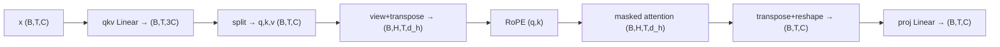

# Step 08. Multi-Head Causal Self-Attention

- 구현: `minillm/layers.py` — `CausalSelfAttention.forward` (KV cache 연결부는 step 14에서 사용)
- 테스트: `pytest tests/test_08_causal_attention.py`
- 선행: step 06, 07

## 1. 목표

입력 $X \in \mathbb R^{B \times T \times C}$를 $H$개의 head로 나눠 RoPE를 적용하고 causal attention을 계산한 뒤 출력 투영하는 모듈을 구현한다. KV cache(step 14)와 호환되도록 마스크를 일반화된 형태로 만든다.

## 2. 이론

### 2.1 자기회귀 분해와 causal mask

언어 모델은 $p(x_1, \dots, x_T) = \prod_t p(x_t \mid x_{<t})$로 분해한다. 학습 시에는 모든 위치의 다음 토큰 예측을 한 번의 forward로 병렬 계산한다(teacher forcing). 이를 위해 위치 $t$의 출력이 $x_{\le t}$에만 의존해야 하며, attention에서 $j > t$인 key를 가리는 하삼각 마스크로 보장한다. 모든 서브레이어(projection, MLP, norm)는 위치별(position-wise) 연산이므로 attention만 마스크하면 전체 네트워크가 causal해진다.

### 2.2 Multi-head

$$\mathrm{head}_h = \mathrm{Attn}(XW_Q^{(h)}, XW_K^{(h)}, XW_V^{(h)}),\qquad \mathrm{MHA}(X) = [\mathrm{head}_1; \dots; \mathrm{head}_H]\,W_O$$

$d_h = C/H$. 파라미터 수는 $W_Q, W_K, W_V, W_O$ 합쳐 $4C^2$으로 $H$와 무관하다. 한 head의 attention logit 행렬 $Q_hK_h^\top$은 rank가 $d_h$ 이하이다. head를 여러 개 두면 같은 비용으로 서로 다른 부분공간에서 서로 다른 attention 패턴(예: 직전 토큰, 구문적으로 관련된 토큰)을 동시에 학습할 수 있다.

구현에서는 $W_Q, W_K, W_V$를 하나의 `Linear(C, 3C)`로 합쳐 한 번의 matmul로 계산한 뒤 split한다.

### 2.3 KV cache를 고려한 마스크

생성 시(step 14)에는 과거 key/value가 cache에 있고 새 query는 $T$개(prefill이면 프롬프트 길이, decode면 1)이다. key의 총 개수를 $T_k$라 하면 새 query $i$($0 \le i < T$)의 절대 위치는 $T_k - T + i$이고, 허용되는 key는 $j \le T_k - T + i$이다.

$$\mathrm{mask}[i, j] = \mathbb 1[j \le i + (T_k - T)] \;\Rightarrow\; \texttt{torch.ones(T, Tk).tril(diagonal=Tk - T)}$$

cache가 없으면 $T_k = T$이므로 일반적인 하삼각 마스크가 된다. 이 일반형 하나로 학습·prefill·decode를 모두 처리한다.

### 2.4 FLOPs (토큰 $T$개, 한 레이어, forward)

- QKV 투영 $6TC^2$, 출력 투영 $2TC^2$
- $QK^\top$: $2T^2C$, 가중합: $2T^2C$

$T \ll C$이면 투영이 지배적이고, $T$가 커지면 $T^2$ 항이 지배적이 된다.

## 3. 예제로 따라가기

### 3.1 shape 따라가기

$B = 2$, $T = 5$, $C = 16$, $H = 4$ ($d_h = 4$):

| 단계 | 코드 | shape |
|---|---|---|
| 입력 | `x` | (2, 5, 16) |
| QKV 투영 | `self.qkv(x)` | (2, 5, 48) |
| 분리 | `.split(16, dim=-1)` | q, k, v 각 (2, 5, 16) |
| head 분할 | `.view(2, 5, 4, 4)` | (2, 5, **4**, 4) — 16 = 4 head × 4 차원 |
| head를 앞으로 | `.transpose(1, 2)` | (2, **4**, 5, 4) — (B, H, T, d_h) |
| RoPE | `apply_rope(q, cos, sin)` | (2, 4, 5, 4) |
| score | $QK^\top/\sqrt{d_h}$ | (2, 4, 5, 5) — head마다 5×5 |
| 출력 | $\alpha V$ | (2, 4, 5, 4) |
| head 합치기 | `.transpose(1, 2).reshape(2, 5, 16)` | (2, 5, 16) |
| 출력 투영 | `self.proj(...)` | (2, 5, 16) |



`view(2, 5, 4, 4)`가 하는 일은 각 토큰의 16차원 벡터를 `[0:4] [4:8] [8:12] [12:16]` 네 덩어리로 나누는 것이다. 덩어리 $h$가 head $h$의 입력이 된다.

### 3.2 마스크 세 가지 상황

`torch.ones(T, Tk).tril(diagonal=Tk - T)` 하나로 모두 처리된다. 1 = 참조 허용.

**학습 / prefill** ($T = T_k = 5$, diagonal 0):

```
         key 0 1 2 3 4
query 0      1 0 0 0 0
query 1      1 1 0 0 0
query 2      1 1 1 0 0
query 3      1 1 1 1 0
query 4      1 1 1 1 1
```

**cache에 3개가 있고 새 토큰 2개** ($T = 2$, $T_k = 5$, diagonal 3): 새 query의 절대 위치는 3, 4이다.

```
         key 0 1 2 3 4
query 0(=위치3) 1 1 1 1 0
query 1(=위치4) 1 1 1 1 1
```

**decode, 토큰 1개** ($T = 1$, $T_k = 5$, diagonal 4): 과거 전체를 본다.

```
         key 0 1 2 3 4
query 0(=위치4) 1 1 1 1 1
```

diagonal을 0으로 고정하면 마지막 경우 첫 행이 `1 0 0 0 0`이 되어 새 토큰이 첫 토큰만 보게 된다(해설 08의 3번).

### 3.3 파라미터 수

$C = 384$ (m5 프리셋):

| 가중치 | shape | 개수 |
|---|---|---|
| `qkv` | (1152, 384) | 442,368 |
| `proj` | (384, 384) | 147,456 |
| 합 | | 589,824 $= 4C^2$ |

head 수를 6에서 12로 바꿔도 이 수는 같다. head 수는 $C$를 몇 조각으로 나누는지만 정한다.

## 4. 구현 가이드

1. `self.qkv(x).split(C, dim=-1)` → 각각 `(B, T, C)`.
2. `view(B, T, H, d_h).transpose(1, 2)` → `(B, H, T, d_h)`.
3. `apply_rope(q, cos, sin)`, `apply_rope(k, cos, sin)`.
4. (제공됨) cache가 있으면 `k, v = cache.update(k, v)`.
5. 2.3의 마스크로 `scaled_dot_product_attention`.
6. `transpose(1, 2).reshape(B, T, C)` 후 `self.proj`. transpose 후 메모리가 연속적이지 않으므로 `view` 대신 `reshape`를 쓴다.

forward 본문은 마커상 두 구간으로 나뉘어 있다. 1–3을 첫 구간에, 5–6을 두 번째 구간에 작성한다.

## 5. 검증

같은 가중치로 `F.scaled_dot_product_attention(is_causal=True)` 기반 참조 구현과 비교하고, 미래 토큰을 바꿔도 과거 위치의 출력이 변하지 않는지(causality) 확인한다.

## 6. 확인 문제

> 해설: [answers/08_causal_attention.md](answers/08_causal_attention.md) — 먼저 직접 풀어 본 뒤 확인할 것.

1. causal mask 없이 학습한 모델은 학습 loss가 매우 낮게 나온다. 이유는 무엇이고 생성 시 어떤 일이 벌어지는가?
2. Multi-Query Attention(K, V head 1개)과 Grouped-Query Attention(K, V head $G$개)의 파라미터 수와 KV cache 크기(step 14)를 $H$, $G$, $d_h$로 표현하라.
3. 2.3의 마스크에서 diagonal 오프셋을 0으로 두면 decode 단계($T = 1$)에서 무엇이 잘못되는가?

## 참고문헌

- A. Vaswani et al., "Attention Is All You Need," NeurIPS 2017.
- A. Radford et al., "Language Models are Unsupervised Multitask Learners," 2019.
- N. Shazeer, "Fast Transformer Decoding: One Write-Head is All You Need," arXiv:1911.02150, 2019.
- J. Ainslie et al., "GQA: Training Generalized Multi-Query Transformer Models from Multi-Head Checkpoints," EMNLP 2023.
