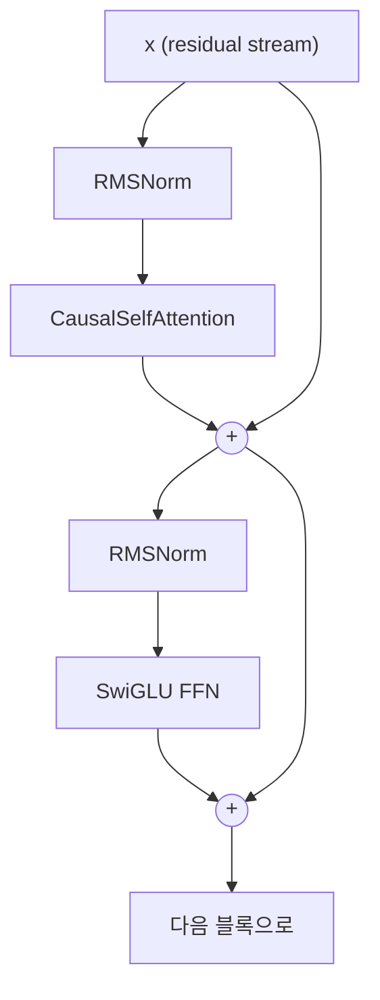

# Step 09. RMSNorm, SwiGLU, Pre-norm Transformer Block

- 구현: `minillm/layers.py` — `RMSNorm.forward`, `SwiGLU.forward`, `Block.forward`
- 테스트: `pytest tests/test_09_block.py`
- 선행: step 08

## 1. 목표

LLaMA 계열의 블록 구성(pre-norm + RMSNorm + SwiGLU FFN)을 구현한다.

## 2. 이론

### 2.1 Residual stream

$$x_{l+1} = x_l + F_l(x_l) \;\Rightarrow\; \frac{\partial x_L}{\partial x_l} = I + \sum(\text{서브레이어 Jacobian들의 곱으로 된 항})$$

항등 경로가 있으므로 깊은 네트워크에서도 gradient가 소실되지 않는다(He et al. 2016). Transformer에서 각 블록은 attention과 FFN 두 개의 residual 기여를 더한다. 이 누적 구조는 step 10의 초기화 스케일 근거가 된다.

### 2.2 Post-norm vs Pre-norm

- Post-norm(원 논문): $x \leftarrow \mathrm{LN}(x + F(x))$
- Pre-norm(GPT-2 이후): $x \leftarrow x + F(\mathrm{LN}(x))$

Xiong et al. (2020)은 post-norm에서 초기화 시점의 출력층 근처 gradient가 커서 warmup 없이는 학습이 불안정함을 보였다. pre-norm은 residual 경로에 정규화가 없어 gradient가 깊이에 걸쳐 고르게 흐른다. 대신 residual stream의 크기가 정규화되지 않으므로 마지막에 final norm이 필요하다(step 10의 `self.norm`).

### 2.3 LayerNorm → RMSNorm

$$\mathrm{RMSNorm}(x) = \frac{x}{\sqrt{\frac1D\sum_i x_i^2 + \epsilon}} \odot g$$

평균 제거와 bias를 생략한다. Zhang & Sennrich (2019)는 LayerNorm 효과의 대부분이 re-centering이 아니라 re-scaling 불변성에서 온다고 보고, 계산이 더 적은 RMSNorm이 동등한 성능을 낸다고 보였다. gain $g$는 1로 초기화한다.

### 2.4 FFN과 SwiGLU

원래 FFN은 $W_2\,\sigma(W_1 x)$(hidden $4d$). GLU 계열(Dauphin et al. 2017; Shazeer 2020)은 게이트를 곱한다:

$$\mathrm{SwiGLU}(x) = W_{down}\big(\mathrm{SiLU}(W_{gate}x) \odot W_{up}x\big),\qquad \mathrm{SiLU}(z) = z\,\sigma(z).$$

행렬이 3개이므로 파라미터를 2-행렬 FFN($2 \cdot d \cdot 4d = 8d^2$)과 맞추려면 $3dh = 8d^2$, 즉 $h = \frac{8}{3}d$. 이 레포의 m5 프리셋은 $d = 384 \Rightarrow h = 1024$.

### 2.5 블록 파라미터 수

attention $4d^2$ + FFN $3dh$ + RMSNorm 2개 $2d$.

## 3. 예제로 따라가기

### 3.1 RMSNorm vs LayerNorm을 같은 입력에

$x = [1, 2, 3, 4]$, gain = 1.

| | 계산 | 출력 |
|---|---|---|
| RMSNorm | $\mathrm{rms} = \sqrt{(1+4+9+16)/4} = 2.7386$, $x/\mathrm{rms}$ | [0.3651, 0.7303, 1.0954, 1.4606] |
| LayerNorm | 평균 2.5를 빼고 표준편차 1.118로 나눔 | [−1.3416, −0.4472, 0.4472, 1.3416] |
| RMSNorm, 입력 $x + 10$ | | [0.8765, 0.9562, 1.0359, 1.1155] — 달라짐 |
| RMSNorm, 입력 $10x$ | | [0.3651, 0.7303, 1.0954, 1.4606] — 같음 |

RMSNorm은 평균을 빼지 않으므로 출력 평균이 0이 아니고, 상수를 더하면 결과가 바뀐다. 크기를 키우는 것에는 불변이다.

### 3.2 SiLU와 그 도함수

| $z$ | −3 | −2 | −1 | −0.5 | 0 | 0.5 | 1 | 2 | 3 |
|---|---|---|---|---|---|---|---|---|---|
| ReLU | 0 | 0 | 0 | 0 | 0 | 0.5 | 1 | 2 | 3 |
| SiLU $z\sigma(z)$ | −0.1423 | −0.2384 | **−0.2689** | −0.1888 | 0 | 0.3112 | 0.7311 | 1.7616 | 2.8577 |
| SiLU′ | −0.0881 | −0.0908 | 0.0723 | 0.26 | 0.5 | 0.74 | 0.9277 | 1.0908 | 1.0881 |

- 큰 양수에서는 ReLU와 거의 같다.
- 음수에서도 0이 아닌 작은 값과 gradient가 있다. ReLU의 dead neuron 문제가 없다.
- 약 $z = -1.28$에서 최솟값(−0.278)을 가지는 비단조 함수이고, 도함수가 1을 약간 넘는 구간도 있다.

### 3.3 블록 안의 데이터 흐름

정규화는 서브레이어의 **입력**에만 걸리고, residual 경로(왼쪽 직선)에는 아무것도 걸리지 않는다. 이것이 pre-norm이다. post-norm은 `+` 뒤에 정규화를 둔다.

### 3.4 SwiGLU 한 토큰

$d = 384$, $h = 1024$일 때 한 토큰 $x$ (384)에서:

| 단계 | shape |
|---|---|
| $g = W_{gate}x$, $u = W_{up}x$ | 각 (1024) |
| $\mathrm{SiLU}(g) \odot u$ | (1024) — 원소별 곱: $g$가 $u$의 각 성분을 얼마나 통과시킬지 정한다 |
| $W_{down}(\cdot)$ | (384) |

블록 하나의 파라미터: attention $4d^2 = 589{,}824$ + FFN $3dh = 1{,}179{,}648$ + RMSNorm $2d = 768$ = **1,770,240**. FFN이 attention의 두 배다.

## 4. 구현 가이드

- `RMSNorm`: `x * torch.rsqrt(x.pow(2).mean(-1, keepdim=True) + eps) * weight`.
- `SwiGLU`: `F.silu`를 써도 되지만 `g * torch.sigmoid(g)`로 직접 써 보는 것을 권장.
- `Block`: `x = x + attn(norm1(x), cos, sin, cache)`, `x = x + ffn(norm2(x))`. cache 인자를 attention에 그대로 전달해야 step 14가 동작한다.

## 5. 검증

`F.rms_norm`, `F.silu` 기반 참조와 비교하고, 블록 출력이 pre-norm residual 합성과 같은지 확인한다.

## 6. 확인 문제

> 해설: [answers/09_block.md](answers/09_block.md) — 먼저 직접 풀어 본 뒤 확인할 것.

1. SiLU의 도함수를 구하고, ReLU와 달리 음수 입력에서도 gradient가 0이 아닌 이유를 설명하라.
2. pre-norm에서 final norm을 빼면 lm_head 입력의 스케일은 깊이에 따라 어떻게 되는가?
3. RMSNorm의 출력은 입력의 어떤 변환에 불변인가? LayerNorm과 비교하라.

## 참고문헌

- K. He et al., "Deep Residual Learning for Image Recognition," CVPR 2016.
- R. Xiong et al., "On Layer Normalization in the Transformer Architecture," ICML 2020.
- B. Zhang, R. Sennrich, "Root Mean Square Layer Normalization," NeurIPS 2019.
- Y. N. Dauphin et al., "Language Modeling with Gated Convolutional Networks," ICML 2017.
- N. Shazeer, "GLU Variants Improve Transformer," arXiv:2002.05202, 2020.
- H. Touvron et al., "LLaMA: Open and Efficient Foundation Language Models," arXiv:2302.13971, 2023.
