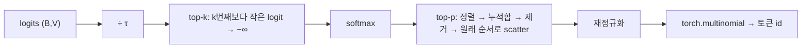

# Step 13. 디코딩: temperature, top-k, nucleus sampling

- 구현: `minillm/generate.py` — `filter_probs`, `sample_next`, `generate`의 샘플링 구간
- 테스트: `pytest tests/test_13_sampling.py`
- 선행: step 10

## 1. 목표

다음 토큰 분포에서 토큰을 고르는 전략들을 구현하고, 자기회귀 생성 루프를 완성한다(KV cache 없는 버전).

## 2. 이론

### 2.1 탐색 vs 샘플링

- **Greedy**: $\arg\max_i p_i$. 결정적이며, 개방형 생성에서는 같은 구절을 반복하는 퇴화가 잘 일어난다.
- **Beam search**: 높은 우도의 시퀀스를 찾는다. 번역처럼 정답이 좁은 과제에 적합하지만, 개방형 생성에서는 사람이 쓴 텍스트보다 우도가 지나치게 높은 단조로운 텍스트를 낸다(Holtzman et al. 2020).
- **Sampling**: 분포에서 추출한다. 꼬리의 저확률 토큰이 누적되면 문맥에서 벗어나므로 분포를 잘라내는 기법과 함께 쓴다.

### 2.2 Temperature

$$p_i^{(\tau)} = \frac{\exp(z_i/\tau)}{\sum_j\exp(z_j/\tau)}$$

$\tau \to 0$이면 argmax로 수렴하고 $\tau \to \infty$이면 균등분포로 수렴한다. 엔트로피는 $\tau$에 대해 단조 증가한다. $\tau = 0$은 0 나눗셈이 되므로 greedy로 특수 처리한다.

### 2.3 Top-k (Fan et al. 2018)

logit 상위 $k$개만 남기고 나머지를 $-\infty$로 둔 뒤 softmax. 분포가 뾰족할 때도 평평할 때도 같은 $k$를 쓴다는 한계가 있다.

### 2.4 Nucleus / top-p (Holtzman et al. 2020)

확률 내림차순으로 정렬했을 때 누적합이 $p$ 이상이 되는 **최소** 집합 $V_p$만 남기고 재정규화한다:

$$V_p = \arg\min_{V'} |V'| \quad \text{s.t.}\quad \sum_{i \in V'} p_i \ge p.$$

분포가 뾰족하면 후보가 적고, 평평하면 많아져 분포 모양에 적응한다.

구현: 정렬된 확률 $\tilde p$와 누적합 $c$에 대해, **자기 자신을 제외한** 앞선 누적합 $c_i - \tilde p_i$가 이미 $p$ 이상인 토큰을 제거한다. 그러면 임계값을 처음 넘게 만드는 토큰까지 포함된다. 예: $[0.5, 0.3, 0.15, 0.05]$, $p = 0.7$ → 앞선 누적합 $[0, 0.5, 0.8, 0.95]$ → 앞의 두 개 유지 → $[0.625, 0.375, 0, 0]$.

### 2.5 적용 순서

`logits / τ` → top-k(logit 공간) → softmax → top-p(확률 공간) → 재정규화 → `torch.multinomial`.

### 2.6 생성 루프와 비용

매 스텝 지금까지의 시퀀스(최근 `block_size`개)를 모델에 넣어 마지막 위치의 logits로 다음 토큰을 뽑는다. 길이 $t$의 시퀀스를 매번 다시 계산하므로 $n$개 토큰 생성 비용은 $O(\sum_t t) = O(n^2)$ 토큰-forward이다. step 14의 KV cache가 이를 $O(n)$으로 줄인다.

EOS 처리: 배치 중 EOS를 낸 시퀀스는 이후 EOS로 채우고(`done` 마스크), 모두 끝나면 조기 종료한다(제공됨).

## 3. 예제로 따라가기

이하 모든 예는 다음 토큰 후보 5개의 logit $z = [2.0,\ 1.0,\ 0.5,\ 0.0,\ -1.0]$ (토큰 A–E)을 쓴다.

### 3.1 temperature가 분포를 바꾸는 모습

| $\tau$ | A | B | C | D | E | 엔트로피 (nats) |
|---|---|---|---|---|---|---|
| 0 (greedy) | 1 | 0 | 0 | 0 | 0 | 0 |
| 0.5 | 0.8292 | 0.1122 | 0.0413 | 0.0152 | 0.0021 | 0.609 |
| 1.0 | 0.5630 | 0.2071 | 0.1256 | 0.0762 | 0.0280 | 1.206 |
| 2.0 | 0.3745 | 0.2272 | 0.1769 | 0.1378 | 0.0836 | 1.491 |
| ∞ | 0.2 | 0.2 | 0.2 | 0.2 | 0.2 | $\ln 5 = 1.609$ |

$\tau$가 작을수록 1등에 몰리고, 클수록 균등에 가까워진다. 순위는 바뀌지 않는다.

### 3.2 top-k ($k = 2$)

| 단계 | A | B | C | D | E |
|---|---|---|---|---|---|
| logit | 2.0 | 1.0 | 0.5 | 0.0 | −1.0 |
| 2등 logit(1.0)보다 작은 것을 $-\infty$로 | 2.0 | 1.0 | −∞ | −∞ | −∞ |
| softmax | **0.7311** | **0.2689** | 0 | 0 | 0 |

남은 두 토큰의 비율 $0.7311/0.2689 = e^{1.0} = 2.718$은 원래 분포의 비율 $0.5630/0.2071$과 같다. 잘라낸 뒤 재정규화만 한 것이다.

### 3.3 top-p를 한 줄씩

$\tau = 1$ 분포를 내림차순으로 정렬:

| 순위 | 토큰 | $p$ | 누적합 | 자기 제외 누적합 | $p = 0.8$일 때 | $p = 0.9$일 때 |
|---|---|---|---|---|---|---|
| 1 | A | 0.5630 | 0.5630 | 0.0000 | 유지 | 유지 |
| 2 | B | 0.2071 | 0.7701 | 0.5630 | 유지 | 유지 |
| 3 | C | 0.1256 | 0.8958 | 0.7701 | **유지** (0.7701 < 0.8) | 유지 |
| 4 | D | 0.0762 | 0.9720 | 0.8958 | 제거 (≥ 0.8) | **유지** (0.8958 < 0.9) |
| 5 | E | 0.0280 | 1.0000 | 0.9720 | 제거 | 제거 |

"자기 제외 누적합이 이미 $p$ 이상이면 제거"하므로, 누적합을 처음으로 $p$ 이상으로 만드는 토큰(0.8일 때 C)까지 남는다.

| | A | B | C | D | E |
|---|---|---|---|---|---|
| top-p 0.8 재정규화 | 0.6285 | 0.2312 | 0.1402 | 0 | 0 |
| top-p 0.9 재정규화 | 0.5793 | 0.2131 | 0.1293 | 0.0784 | 0 |

top-k와 달리 남는 개수가 분포 모양에 따라 바뀐다. 분포가 뾰족하면($\tau = 0.5$) top-p 0.8은 A 하나만 남긴다(0.8292 ≥ 0.8).

### 3.4 적용 순서

### 3.5 생성 루프 한 바퀴씩 (cache 없음)

프롬프트 `[a, b]`, 2개 생성:

| 스텝 | 모델 입력 | 사용하는 logits | 뽑힌 토큰 | 이후 시퀀스 |
|---|---|---|---|---|
| 1 | `[a, b]` | 위치 1(`b`)의 logits | `c` | `[a, b, c]` |
| 2 | `[a, b, c]` | 위치 2(`c`)의 logits | `d` | `[a, b, c, d]` |

스텝 2에서 `a`, `b`를 다시 계산한다. 이 중복 계산을 없애는 것이 step 14의 KV cache이다.

## 4. 구현 가이드

- `filter_probs`: top-k는 `logits.topk(k).values[..., -1:]`(k번째 값)보다 작은 logit을 $-\infty$로. top-p는 `sort(descending=True)` → `cumsum` → 마스크 → `scatter`로 원래 순서 복원 → 재정규화. softmax는 step 02 구현을 쓴다.
- `sample_next`: `temperature == 0`이면 `argmax`, 아니면 `torch.multinomial(probs, 1, generator=generator)`.
- `generate`의 마커 구간: cache가 없으면 `idx[:, -block_size:]`를 입력, 있으면 `inp`(제공되는 루프가 첫 스텝에 프롬프트 전체, 이후 직전 토큰을 넣어 준다)를 입력한다.

## 5. 검증

greedy, top-k 비율 보존, top-p 경계 사례, 20000회 샘플링 빈도가 softmax 확률과 일치하는지, 생성 shape과 EOS 조기 종료를 확인한다.

## 6. 확인 문제

> 해설: [answers/13_sampling.md](answers/13_sampling.md) — 먼저 직접 풀어 본 뒤 확인할 것.

1. top-p = 1, top-k = None, τ = 1이면 어떤 분포에서 샘플링하는가?
2. τ < 1과 top-p를 함께 쓸 때 순서를 바꾸면(top-p 먼저) 결과가 달라지는가?
3. repetition penalty(이미 나온 토큰의 logit을 낮춤)를 `filter_probs` 앞단에 추가한다면 어떤 형태가 되는가?

## 참고문헌

- A. Holtzman et al., "The Curious Case of Neural Text Degeneration," ICLR 2020.
- A. Fan, M. Lewis, Y. Dauphin, "Hierarchical Neural Story Generation," ACL 2018.
- D. H. Ackley, G. E. Hinton, T. J. Sejnowski, "A Learning Algorithm for Boltzmann Machines," Cognitive Science 1985 (temperature).
